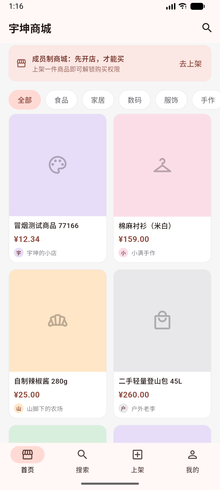

# 宇坤商城（yukunyuan-mall）

一个只对「开店成员」开放的会员制商城：**每个人既是卖家也是买家**，先上架自己的商品，才能购买别人的商品。

仓库是前端 + 后端两个独立工程，互不依赖构建：

| 目录 | 内容 | 技术栈 | 说明 |
| --- | --- | --- | --- |
| [`app-flutter/`](app-flutter) | 安卓 App（后续可扩 iOS/Web） | Flutter 3.47.9 / Dart 3.13.7 | [客户端 README](app-flutter/README.md) |
| [`backend/`](backend) | 商品服务 | Kotlin 2.3 / Spring Boot 4.1 / PostgreSQL 18 | [后端 README](backend/README.md) |

## 现在的状态

- 商品列表、分类筛选、关键字搜索、商品详情、上架商品，前后端已经打通（真实 HTTP 请求）
- 商城首页在 Android 模拟器上的效果：



## 快速开始

```powershell
# 1) 后端（需要本机 PostgreSQL 已建库 yukunyuan_mall）
cd backend
.\gradlew.bat bootRun            # http://localhost:8080

# 2) App（另开一个终端）
cd app-flutter
$env:Path = 'D:\software\flutter\bin;' + $env:Path
flutter pub get
flutter run                      # 有模拟器/真机时直接跑；也可 flutter run -d edge
```

后端地址不用改代码：模拟器自动走 `10.0.2.2:8080`，Web 走 `localhost:8080`，真机用
`--dart-define=API_BASE_URL=http://<电脑局域网IP>:8080` 覆盖。

## 接口一览

| 方法 | 路径 | 说明 |
| --- | --- | --- |
| GET | `/api/health` | 连通性探测 |
| GET | `/api/products?category=&q=` | 商品列表 / 分类筛选 / 关键字搜索 |
| GET | `/api/products/{id}` | 商品详情 |
| POST | `/api/products` | 上架商品，成功 201 |

字段与金额约定见 [backend/README.md](backend/README.md#接口)：**金额统一用「分」的整数**，0 表示面议。

## 还没做

账号与登录、「是否开过店」的购买资格校验、下单与支付、商品图片上传、商品分页。
