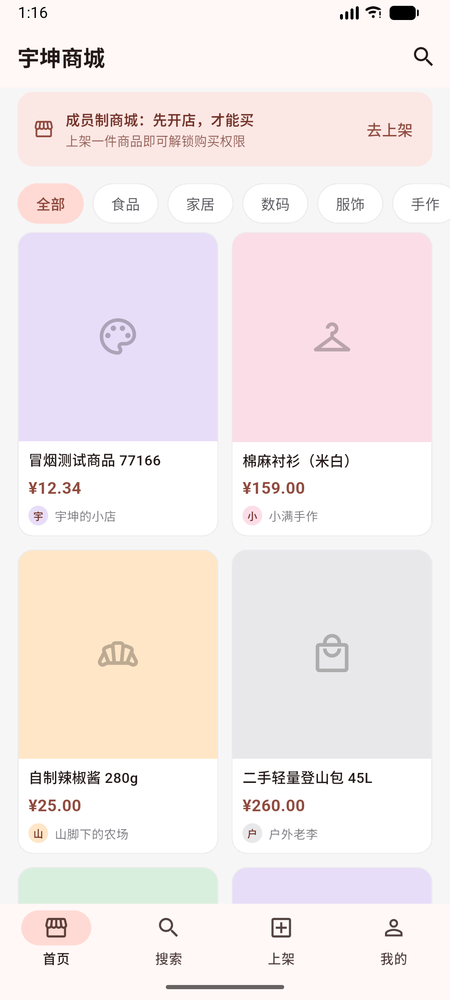
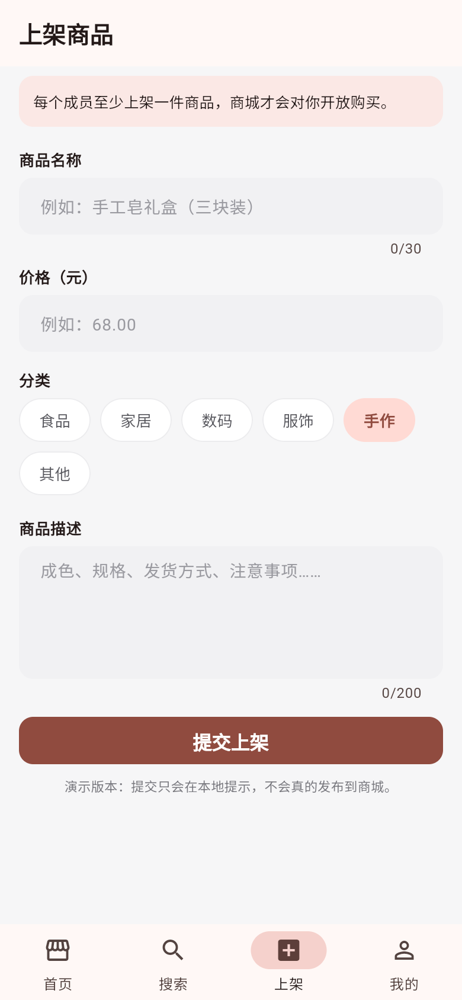

# 宇坤商城（yukunyuan_mall）

一个只对「开店成员」开放的会员制商城的 Flutter 客户端：**每个人既是卖家也是买家**，先上架自己的商品，才能购买别人的商品。

界面已经接上 `../backend`（Kotlin + Spring Boot + PostgreSQL）的商品接口，首页数据、搜索、上架都是真实请求，不再是本地假数据。

| 首页（数据来自后端） | 上架商品 |
| --- | --- |
|  |  |

## 当前已实现

| 功能 | 走的接口 |
| --- | --- |
| 首页商品流、分类筛选、下拉刷新 | `GET /api/health`、`GET /api/products?category=` |
| 搜索（标题 / 描述 / 店铺），输入防抖 300ms | `GET /api/products?q=`，输入分类名时改用 `category=` |
| 商品详情（进入页再用最新数据刷新库存） | `GET /api/products/{id}` |
| 上架商品（表单校验 + 提交） | `POST /api/products` |
| 加载中 / 请求失败重试 / 空态 / 售罄角标 | — |
| 中文界面、Material 3 主题、价格千分位 | — |

- `flutter analyze` 0 issue；12 个离线测试全绿（含接口层单测，用 `MockClient` 打桩，不需要后端）。
- 另有 1 个真实后端冒烟测试（默认跳过）。

## 跑起来

### 1. 先启动后端

后端在 `../backend`（Spring Boot，默认 8080，需要本机 PostgreSQL）。它有独立的 README，简述：

```powershell
cd ..\backend
.\gradlew.bat bootRun
```

确认后端活着：

```powershell
curl.exe http://localhost:8080/api/health
# {"status":"ok","service":"mall-backend"}
curl.exe "http://localhost:8080/api/products?category=手作"
```

### 2. 再跑 App

```powershell
$env:Path = 'D:\software\flutter\bin;' + $env:Path
cd D:\workSpace\yukunyuan-mall\app-flutter
flutter pub get
flutter run                     # 有安卓设备/模拟器时自动选它
flutter run -d emulator-5554    # 指定模拟器
flutter run -d edge             # 只想在浏览器里看
```

**后端地址是按运行环境自动选的**（`lib/core/config/api_config.dart`）：

| 运行环境 | 默认地址 |
| --- | --- |
| Android 模拟器 | `http://10.0.2.2:8080`（10.0.2.2 才是宿主机） |
| Web / Windows | `http://localhost:8080` |
| 真机 | 需要显式指定电脑的局域网 IP |

真机调试（手机和电脑同一 Wi-Fi，防火墙放行 8080）：

```powershell
flutter run --dart-define=API_BASE_URL=http://192.168.1.10:8080
```

## 常用命令

```powershell
flutter analyze                                        # 静态检查
flutter test                                           # 离线测试（12 个）
$env:LIVE_API = '1'; flutter test test/live_api_smoke_test.dart   # 真实后端冒烟（会写一条测试商品）
flutter build web                                      # 产出 build/web
flutter build apk --debug                              # 产出 build/app/outputs/flutter-apk/app-debug.apk
adb install -r build\app\outputs\flutter-apk\app-debug.apk
```

## 已装好的环境

| 项 | 版本 / 位置 |
| --- | --- |
| Flutter | 3.47.9（stable），`D:\software\flutter`（未加进系统 PATH） |
| Dart | 3.13.7 |
| Android Studio | `D:\software\androidStudio`（Flutter/Dart 插件已装） |
| Android SDK | `D:\Android\Sdk`（platform 37、build-tools 36、emulator） |
| JDK | 25（`D:\Java\jdk-25.0.5.0.3`，Android Studio 用自带 JBR） |
| 模拟器 | AVD `Medium_Phone_API_37.0`（`flutter emulators --launch Medium_Phone_API_37.0`） |

国内网络提示：项目里已经把 `android/gradle/wrapper/gradle-wrapper.properties` 的 Gradle 发行包换成腾讯云镜像（官方地址会 302 到 github.com，经常连不上）。

## 目录结构

```
lib/
  main.dart                      入口
  app.dart                       MaterialApp：主题、中文、注入 ProductApi
  core/
    config/api_config.dart       后端地址（按平台/--dart-define 解析）
    theme/app_theme.dart         Material 3 主题、分类配色/图标
    utils/price.dart             「分」→「¥1,299.00」，元→分的解析
    widgets/category_pill.dart   分类胶囊按钮
  models/product.dart            Product + ProductDraft（与后端 DTO 字段对齐）
  data/
    product_api.dart             ProductApi 抽象 + HttpProductApi 实现
    api_exception.dart           ApiException（含 statusCode / code / fieldErrors）
    mock_products.dart           分类常量 + 演示数据（只在测试里用）
  shell/main_shell.dart          底部四栏，创建并下发同一个 ProductApi
  features/
    home/home_page.dart          首页：加载/错误/空态、分类切换、下拉刷新
    home/product_detail_page.dart
    home/widgets/                提示条、分类条、商品卡片
    search/search_page.dart
    publish/publish_page.dart
    profile/profile_page.dart
test/
  price_test.dart、home_page_test.dart（用 FakeProductApi）
  product_api_test.dart          接口层单测（MockClient）
  fake_product_api.dart          内存假实现，筛选规则与后端一致
  live_api_smoke_test.dart       真实后端冒烟（LIVE_API=1 才跑）
tool/
  install_flutter.ps1            装 Flutter（一次性）
  screenshot.mjs                 Edge 无头截图
```

## 开发约定

- **金额一律用 `int` 存「分」**（`priceCents`），只在展示时格式化；0 显示「面议」。前后端都不传浮点元。
- **接口层只有一个入口**：页面依赖 `ProductApi` 抽象，真机/测试分别注入 `HttpProductApi` / `FakeProductApi`，页面里不出现 `http`。
- **状态管理暂时只用 `setState`**，不引第三方状态库。
- **不要用 `ChoiceChip`** 做分类按钮：CanvasKit 缺中文字体时会算错固有宽度，把「全部」裁成一个字，统一用 `CategoryPill`。
- **明文 HTTP 只在 debug/profile 打开**（`android/app/src/{debug,profile}/AndroidManifest.xml` 的 `usesCleartextTraffic`），release 包仍只允许 HTTPS；正式上线要换 HTTPS 域名。
- 商品图仍是分类色块占位，等后端加 `imageUrl` 再换成 `Image.network` + 占位图。

## 下一步

1. 账号体系：注册 / 登录 / JWT，「是否开过店」决定能否下单（会员制核心规则）
2. 上架接口带上当前登录用户，前端不再传 `sellerName`
3. 订单与支付：地址、下单、库存扣减（先做线下转账或余额）
4. 商品图片上传（对象存储 + 压缩，后端加 `V2` 迁移）
5. 分页：商品变多后 `GET /api/products` 加 `page/size`
